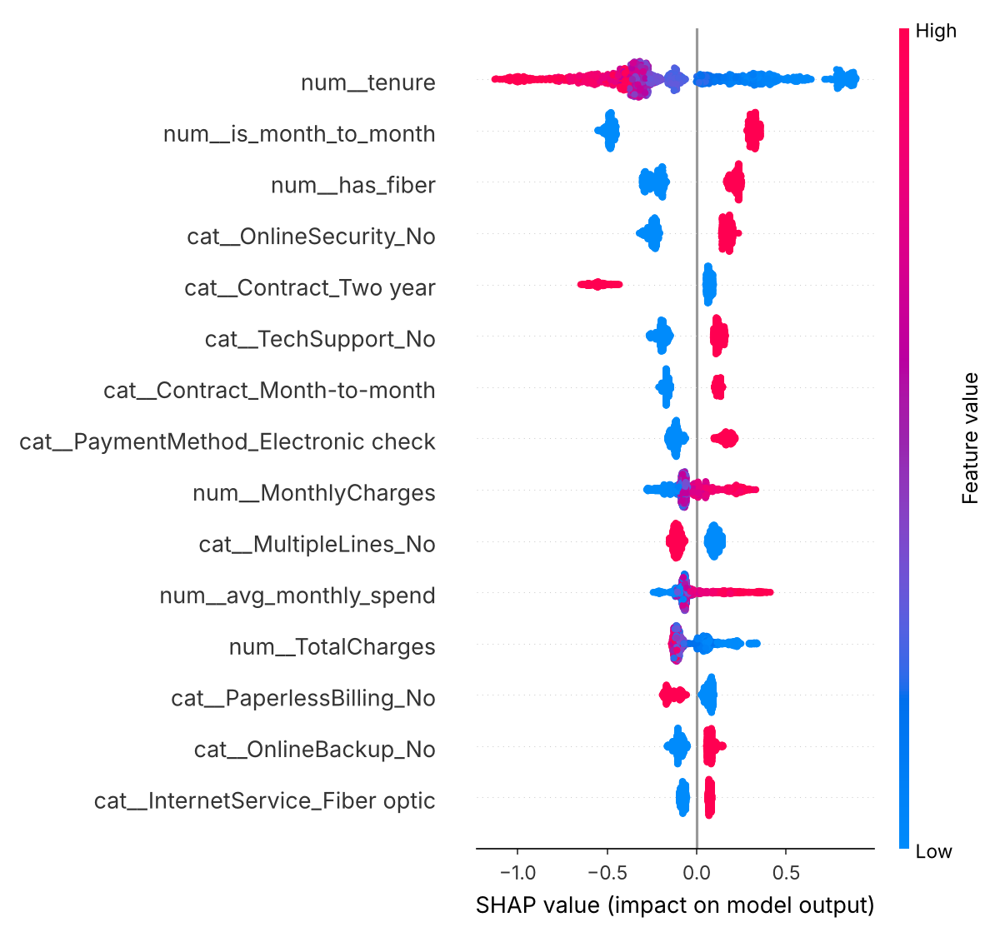

# Customer Churn Prediction & MLOps Pipeline

An end-to-end machine learning project on the public **IBM Telco Customer Churn** dataset (7,043 customers, 26.5% churn).
It covers the full lifecycle a data scientist / ML engineer owns: distributed ETL, feature engineering, model
selection and tuning, calibration, cost-sensitive decisions, explainability, fairness, drift monitoring, experiment
tracking, a REST API, containerization and CI.

```
CSV ──► PySpark ETL + features ──► model zoo (LR · RF · LightGBM · PyTorch MLP · XGBoost+Optuna)
            │  (pandas parity test)        │ stratified 5-fold CV, isotonic calibration
            ▼                              ▼
     features.parquet            MLflow tracking + Model Registry ──► champion.joblib
                                           │
          SHAP · fairness audit · PSI drift · campaign simulation      FastAPI /predict ──► Docker ──► GitHub Actions CI
```

## Results (held-out test set, n = 1,409)

| Model | CV ROC-AUC | Test ROC-AUC | Test PR-AUC | Brier |
|---|---|---|---|---|
| xgboost optuna | 0.850 | 0.847 | 0.664 | 0.135 |
| logistic regression | 0.847 | 0.845 | 0.646 | 0.136 |
| pytorch mlp | 0.845 | 0.842 | 0.641 | 0.137 |
| lightgbm | 0.845 | 0.841 | 0.645 | 0.137 |
| random forest | 0.844 | 0.842 | 0.648 | 0.137 |

Champion: **xgboost optuna** — ROC-AUC **0.847**, PR-AUC **0.664**, top-decile lift **2.85×**.
Spark MLlib baselines on the same features: logistic regression 0.844, gradient-boosted trees 0.844 ROC-AUC.

**Cost-sensitive threshold.** A missed churner is assumed to cost $500 (lost margin) and a retention offer $50. The
threshold is chosen on out-of-fold *training* predictions (never on the test set). At t = 0.09 the model
catches **96%** of churners and expected cost falls from $89,500 (t = 0.5) to
**$34,550** (−61%).

**Retention campaign simulation.** Targeting the top 20% of scored customers (281) reaches
189 churners vs. 65 with random targeting
(net value $14,300 vs. $-4,300, assuming a 30% save rate).

### Explainability (mean |SHAP|, XGBoost)
| Feature | mean abs SHAP |
|---|---|
| tenure | 0.422 |
| is_month_to_month | 0.393 |
| has_fiber | 0.228 |
| OnlineSecurity_No | 0.209 |
| Contract_Two year | 0.185 |
| TechSupport_No | 0.158 |
| Contract_Month-to-month | 0.144 |
| PaymentMethod_Electronic check | 0.137 |



### Fairness audit (test set, at the cost-optimal threshold)
| Group | n | Recall | Flag rate | False-positive rate |
|---|---|---|---|---|
| gender=Female | 687 | 0.96 | 0.65 | 0.52 |
| gender=Male | 722 | 0.96 | 0.63 | 0.52 |
| SeniorCitizen=non-senior | 1187 | 0.95 | 0.60 | 0.49 |
| SeniorCitizen=senior | 222 | 0.99 | 0.85 | 0.74 |

Recall is similar across groups, but senior citizens are flagged far more often (higher false-positive rate), largely
because they churn more in the data. In production this would be reviewed before offers are allocated by score alone.

### Drift monitoring (Population Stability Index)
A simulated production batch with a 15% price increase and more month-to-month contracts:

| Feature | PSI | Status |
|---|---|---|
| MonthlyCharges | 1.289 | major shift |
| tenure | 0.002 | stable |
| TotalCharges | 0.003 | stable |
| num_services | 0.006 | stable |
| is_month_to_month | 0.038 | stable |

## Run it
```bash
pip install -r requirements.txt -r requirements-spark.txt   # PySpark needs Java 17+
pip install torch --index-url https://download.pytorch.org/whl/cpu  # optional: PyTorch MLP
make etl        # PySpark ETL -> data/features.parquet + Spark MLlib baselines
make train      # Optuna tuning, CV, calibration, MLflow logging (sqlite:///mlflow.db) and model registry
make analyze    # SHAP, fairness, PSI drift, campaign simulation -> reports/
make test       # pytest: feature parity (Spark vs pandas), PSI, API contract
make serve      # FastAPI on :8000  (POST /predict, GET /health)
make docker     # containerized API
make mlflow     # MLflow UI
```

Example request:
```bash
curl -X POST localhost:8000/predict -H 'Content-Type: application/json' -d '[{"gender":"Female","SeniorCitizen":0,"Partner":"Yes","Dependents":"No","tenure":2,"PhoneService":"Yes","MultipleLines":"No","InternetService":"Fiber optic","OnlineSecurity":"No","OnlineBackup":"No","DeviceProtection":"No","TechSupport":"No","StreamingTV":"Yes","StreamingMovies":"Yes","Contract":"Month-to-month","PaperlessBilling":"Yes","PaymentMethod":"Electronic check","MonthlyCharges":95.5,"TotalCharges":190.0}]'
```

## Repository layout
```
src/features.py    cleaning + feature engineering (pandas)
src/etl_spark.py   the same features in PySpark + Spark MLlib baselines
src/mlp.py         PyTorch MLP wrapped as a scikit-learn estimator (early stopping, class weighting)
src/train.py       Optuna tuning, model comparison, calibration, threshold selection, MLflow registry
src/analyze.py     SHAP, fairness audit, PSI drift, campaign simulation
app/main.py        FastAPI service with Pydantic validation
tests/             pytest suite (run in CI)
```

Data: IBM Telco Customer Churn sample dataset ([source](https://github.com/IBM/telco-customer-churn-on-icp4d)).
